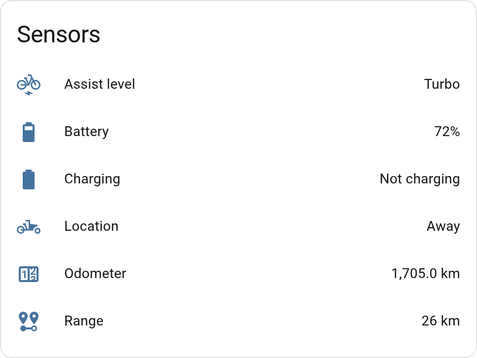
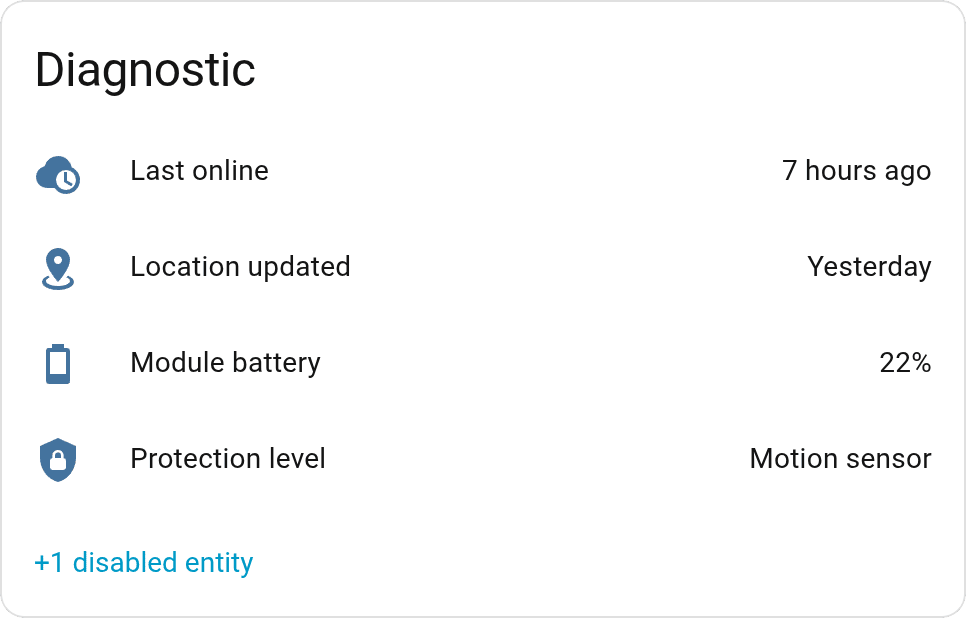
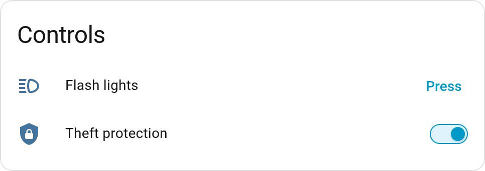
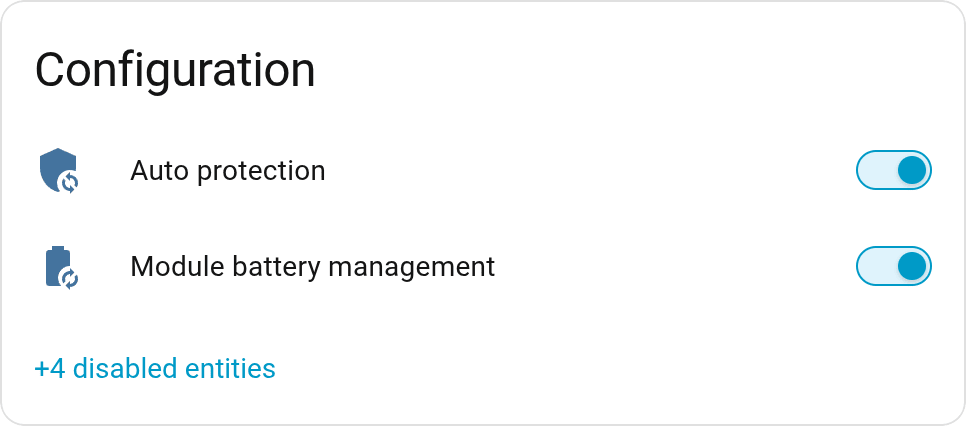

# Urban Arrow for Home Assistant

Brings your connected Urban Arrow cargo bike into Home Assistant: battery level,
range, odometer, GPS location, theft protection, and more. It uses the same
cloud service as the Urban Arrow app.

This is an unofficial integration. It is not made by or affiliated with Urban
Arrow or Pon.

## Screenshots

<table>
  <tr>
    <td></td>
    <td></td>
  </tr>
  <tr>
    <td></td>
    <td></td>
  </tr>
</table>

<!-- ha-marketplace:exclude-start -->
## Installation

### Marketplace (Home Assistant 2026.11 and later)

[](https://my.home-assistant.io/redirect/marketplace_repository/?owner=koenhendriks&repository=ha-urban-arrow&category=integration)

Or open **Settings > Marketplace**, add this repository from its link, and
install **Urban Arrow**.

### HACS

[](https://my.home-assistant.io/redirect/hacs_repository/?owner=koenhendriks&repository=ha-urban-arrow&category=integration)

### Manual

Copy `custom_components/urban_arrow` into the `custom_components` folder of
your Home Assistant configuration and restart Home Assistant.
<!-- ha-marketplace:exclude-end -->

## Setup

[](https://my.home-assistant.io/redirect/config_flow_start/?domain=urban_arrow)

Go to **Settings > Devices & services > Add integration**, choose
**Urban Arrow**, and sign in with the email and password of your Urban Arrow
app account. Every bike on the account becomes a device.

Requirements:

- A smart (connected) Urban Arrow with an active data subscription. Bikes
  without one still show their settings, but no telemetry.
- An account without multi-factor authentication.

## Entities

| Entity | Type | Notes |
|---|---|---|
| Battery | Sensor | Main e-bike battery, % |
| Range | Sensor | Estimated range, km |
| Odometer | Sensor | km |
| Assist level | Sensor | Last used support mode: Off, Eco, Tour, Sport or Turbo |
| Module battery | Sensor (diagnostic) | Backup battery of the connectivity module, % |
| Protection level | Sensor (diagnostic) | Geofence, motion sensor or none |
| Last online | Sensor (diagnostic) | Last time the bike module was online |
| Subscription end | Sensor (diagnostic, disabled) | End of the data subscription |
| Charging | Binary sensor | |
| Location | Device tracker | GPS position of the bike, also shown on the Map |
| Location updated | Sensor (diagnostic) | When the bike last reported its GPS position |
| Flash lights | Button | Find your bike |
| Theft protection | Switch | Arm or disarm theft detection |
| Auto protection | Switch (config) | Arm automatically after riding |
| Module battery management | Switch (config) | |
| Notification switches | Switch (config, disabled) | Push notifications in the app: battery full, battery low, module battery low, protection activated |

The bike only reports when it is awake or riding, so values can be hours old
while it is parked. Data is refreshed every 5 minutes.

## How sign-in works

The Urban Arrow cloud only offers a browser login. The integration fills in that
login form for you, then keeps the session alive with a refresh token. Your
password is stored in Home Assistant so it can sign in again on its own if the
session is ever revoked; if that fails (for example after a password change)
Home Assistant asks you to sign in again.

If Urban Arrow ever adds a captcha to the login page, setup will show an error
saying so; please open an issue in that case.

## Diagnostics and debugging

Download diagnostics from the integration's menu when reporting an issue. Your
email, password, tokens, frame number, IDs and location are removed from it.

To enable debug logging:

```yaml
logger:
  logs:
    custom_components.urban_arrow: debug
    urban_arrow_api: debug
```

## Development

The cloud API is implemented in a separate library,
[urban-arrow-api](https://github.com/koenhendriks/urban-arrow-api).

```bash
uv venv
uv pip install -r requirements_test.txt -e ../urban-arrow-api
uv run --no-project pytest
uv run --no-project ruff check .
```

Releases: bump `version` in `custom_components/urban_arrow/manifest.json`, then
publish a GitHub release whose tag matches it.

## License

MIT
